  

# 🚀 Awesome Data Management Platform (DMP)

  
  
  
  
  
  

> 🌐 **A curated list of leading Data Management Platforms (DMPs), Customer Data Platforms (CDPs), identity resolution engines, privacy-safe clean rooms, and audience activation pipelines.**

Whether you are designing a high-throughput martech data architecture, orchestrating omnichannel marketing segments, integrating cookieless identity resolution (ID graphs), or deploying privacy-first open-source CDP pipelines, this repository provides a comprehensive directory of top enterprise SaaS solutions and developer-friendly open-source frameworks.

---

## 📑 Table of Contents

- [📊 Sector Overview & Market Dynamics](#-sector-overview--market-dynamics)
- [🏢 SaaS & Enterprise Hosted Platforms](#-saas--enterprise-hosted-platforms)
- [💻 Open-Source GitHub Projects](#-open-source-github-projects)
- [🏗️ Architectural Recommendations & Stacks](#-architectural-recommendations--stacks)
- [📈 Star History](#-star-history)
- [🤝 How to Contribute](#-how-to-contribute)
- [📜 Disclaimer](#-disclaimer)

---

## 📊 Sector Overview & Market Dynamics

The global Data Management Platform (DMP) market is estimated at **$2.76B–$3.22B** (projected to reach over $3.8B by 2027 at a 12.4% CAGR). The sector exhibits **moderate fragmentation**, characterized by a bifurcated landscape where enterprise mega-suites (Salesforce, Adobe, Oracle) concentrate broad cross-cloud market share, while specialized, independent vendors and composable open-source alternatives rapidly capture niche ground in cookieless identity resolution, publisher clean rooms, and privacy compliance.

---

## 🏢 SaaS & Enterprise Hosted Platforms

The table below lists category-defining commercial Data Management Platforms and hybrid DMP/CDP engines, sorted in descending order by parent company size (annual revenue / enterprise market valuation).

| 🏢 Platform | 💰 Company Size (Rev / Valuation) | 💵 Starting Tier Pricing | 🎁 Free Tier / Trial Limits | 🔍 Core Capabilities & Overview |
| :--- | :--- | :--- | :--- | :--- |
| **[Oracle BlueKai](https://www.oracle.com/cx/advertising/data-management-platform/)** | ~$53.0B / ~$400B Market Cap | Starts at **$2,500/month** (billed annually at $30,000/yr for entry programmatic data access) | ❌ No self-serve free tier or trial; guided enterprise proof-of-concept (POC) demo available on request | Classic enterprise DMP aggregating 1st, 2nd, and 3rd-party data with 30+ global B2B/B2C taxonomies and native DSP/SSP sync. |
| **[Salesforce Audience Studio](https://www.salesforce.com/products/marketing-cloud/data-management/)** | ~$34.9B / ~$290B Market Cap | Starts at **$2,000/month** ($24,000/year; Data Cloud Starter SKU starts at ~$60,000/year) | ❌ No free tier; 30-day guided sandbox demo upon sales qualification | Omnichannel audience discovery, machine-learning Einstein lookalike modeling, and real-time cross-device identity management. |
| **[Adobe Audience Manager](https://business.adobe.com/products/audience-manager/adobe-audience-manager.html)** | ~$21.5B / ~$230B Market Cap | Starts at **$8,333/month** (~$100,000/year contract based on server call tiers) | ❌ No self-serve free tier or trial; custom enterprise sandbox demo available upon request | Enterprise audience ingestion, cross-channel segment building, algorithmic lookalike models, and Adobe Experience Cloud synergy. |
| **[TransUnion Neustar](https://www.home.neustar/)** | ~$3.8B / ~$18B Market Cap | Starts at **$500/month** (OneID entry tier; enterprise PlatformOne suites scale from $2,500+/month) | ❌ No persistent free tier; custom 14-day data matching test / POC upon sales qualification | Deterministic identity resolution, TruAudience marketing intelligence, offline CRM onboarding, and anti-fraud addressability. |
| **[LiveRamp](https://liveramp.com/)** | ~$660M / ~$2.0B Market Cap | Starts at **$1,667/month** (**$20,000/year** Standard tier for up to 5M customer records) | ❌ No standard free trial; custom token-limited trial POC arranged for enterprise evaluations | Industry-standard identity resolution (RampID), publisher consent management, and privacy-safe collaborative data clean rooms. |
| **[Lotame](https://www.lotame.com/)** | ~$80M / ~$400M Valuation | Starts at **$3,000/month** ($36,000/year base subscription + CPM/event usage fees) | ⚡ Panorama ID free for publishers; core DMP has no free tier (14-day trial POC upon request) | Omnichannel audience curation, cookieless identity graph (Panorama ID), data collaboration marketplace, and buyer onboarding. |
| **[Eyeota](https://www.eyeota.com/)** | ~$45M / ~$180M Valuation | Starts at **$1,500/month** (minimum monthly data commitment / platform activation fee) | ❌ No self-serve free tier or trial; custom sample audience segment data pull upon sales request | Trusted global audience marketplace and data enrichment engine mapping qualified buyer cohorts across 188+ countries. |
| **[Permutive](https://permutive.com/)** | ~$35M / ~$150M Valuation | Starts at **$2,500/month** (annual contract starting at $30,000/year for publishers) | ❌ No free tier or trial; live publisher inventory audit and interactive demo available on request | Edge-computing publisher audience platform enabling real-time edge processing, 100% addressable cohorts, and clean room collaboration. |
| **[Carbon DMP](https://www.carbon.com/)** | ~$15M / ~$60M Valuation | Starts at **$1,200/month** (custom baseline seat + event consumption pricing) | ❌ No persistent free tier; 14-day guided pilot trial available for qualified digital publishers | Specialist real-time publisher monetization DMP offering behavioral taxonomy generation, contextual tagging, and direct revenue optimization. |

---

## 💻 Open-Source GitHub Projects

Open-source Customer Data Platforms (CDPs), event collection backbones, identity engines, and warehouse-native reverse-ETL tools provide transparent, self-hosted, privacy-first alternatives to commercial DMPs. 

Projects below are sorted in descending order by **GitHub Star Count**:

| 💻 Repository | ⭐ Stars | ⚖️ License | 🛠️ Tech Stack | 📖 Description |
| :--- | :--- | :--- | :--- | :--- |
| **[PostHog](https://github.com/PostHog/posthog)** |  | Polyform / MIT | Python, TypeScript, ClickHouse | All-in-one platform featuring event capture, user profiling, session recording, feature flags, and CDP-style data pipelines. |
| **[Plausible Analytics](https://github.com/plausible/analytics)** |  | AGPL-3.0 | Elixir, PostgreSQL, ClickHouse | Lightweight, open-source, privacy-focused analytics software without cookies and fully compliant with GDPR, CCPA, and PECR. |
| **[Airbyte](https://github.com/airbytehq/airbyte)** |  | ELv2 / MIT | Java, Python, React | Extensible open-source data integration platform powering ELT syncs from 300+ advertising, analytics, and CRM endpoints. |
| **[Matomo](https://github.com/matomo-org/matomo)** |  | GPL-3.0 | PHP, MySQL, JavaScript | Enterprise self-hosted web analytics and audience data platform giving complete data ownership and privacy compliance. |
| **[Snowplow](https://github.com/snowplow/snowplow)** |  | Apache-2.0 | Scala, Spark, Kafka | High-performance behavioral event pipeline delivering real-time enriched, modeled customer data directly to cloud warehouses. |
| **[Jitsu](https://github.com/jitsucom/jitsu)** |  | MIT | TypeScript, Go | Modern, high-performance event data collection engine and warehouse-native CDP pipeline with real-time stream routing. |
| **[RudderStack Server](https://github.com/rudderlabs/rudder-server)** |  | SSPL | Go, Node.js, PostgreSQL | Warehouse-native customer data platform core for event streaming, enterprise identity stitching, and downstream tool integration. |
| **[Pimcore](https://github.com/pimcore/pimcore)** |  | GPL-3.0 | PHP, Symfony, MySQL | Open-source enterprise platform integrating Customer Data Platform (CDP) modules alongside Master Data Management (MDM) and PIM. |
| **[Multiwoven](https://github.com/Multiwoven/multiwoven)** |  | Apache-2.0 | Ruby on Rails, React | Open-source Reverse ETL and behavioral data activation tool turning data warehouses into automated operational audience systems. |
| **[Grouparoo](https://github.com/grouparoo/grouparoo)** |  | MPL-2.0 | TypeScript, Node.js | Declarative reverse ETL framework for syncing customer data from relational warehouses to marketing and CRM tools. |
| **[Tracardi](https://github.com/Tracardi/tracardi)** |  | MIT | Python, ElasticSearch | API-first, composable open-source CDP for customer journey tracking, real-time segment calculation, and automated rule workflows. |
| **[Apache Unomi](https://github.com/apache/unomi)** |  | Apache-2.0 | Java, Karaf, ElasticSearch | Reference OASIS Context Server specification implementation providing profiles, segmentation, privacy controls, and personalization. |
| **[LEO CDP Framework](https://github.com/trieu/leo-cdp-framework)** |  | AGPL-3.0 | Java, ArangoDB, Vue.js | AI-first, developer-friendly Customer Data Platform framework for single customer view (SCV) construction and predictive scoring. |

---

## 🏗️ Architectural Recommendations & Stacks

While commercial enterprise DMPs lead in large third-party marketplaces, pre-built identity networks, and turnkey advertising integrations, modern engineering teams frequently compose custom, self-hosted data stacks:

1. **📥 Ingestion & Behavioral Stream Layer**: Deploy **Snowplow** or **Jitsu** for scalable web, mobile, and server-side event collection.
2. **🧠 Identity & Profile Computation**: Utilize **Apache Unomi** or **Tracardi** for deterministic identity stitching, user profiling, and dynamic rule-based audience segmentation.
3. **🏛️ Storage & Modeling (Single Source of Truth)**: Centralize raw events into a modern columnar warehouse (Snowflake, BigQuery, ClickHouse, or PostgreSQL).
4. **🔄 Activation & Reverse ETL**: Use **Multiwoven** or **Grouparoo** to sync computed segments back into advertising networks, marketing automation suites, and CRM destinations.
5. **🛡️ Consent & Governance**: Enforce strict data retention, pseudonymization, and user consent management to ensure compliance with GDPR, CCPA, and modern privacy frameworks.

---

## 📈 Star History

---

## 🤝 How to Contribute

We welcome community contributions! To add a platform or update existing details:

1. 🍴 Fork the repository.
2. 📝 Update `README.md` following the tabular schema:
   - For **SaaS**: specify parent valuation, starting tier pricing, and exact free tier/trial limits.
   - For **Open-Source**: include GitHub repo link, star badge, license, tech stack, and descriptive overview.
3. 🔎 Verify links and ensure all figures are factually grounded.
4. 📬 Submit a Pull Request with a clear description of the addition or update.

---

## 📜 Disclaimer

*All product names, logos, and brands are property of their respective owners. Company valuations and starting pricing tiers represent market benchmarks and public quote data, which may vary based on deployment scale, negotiation, and usage volume.*
